# 📱 Awesome Telephony & Mobile Device Utilities ⚡

<p align="center">
  
</p>

<p align="center">
  <a href="https://github.com/ishandutta2007/Awesome-Awesome-Awesome"></a>
  <a href="https://discord.gg/jc4xtF58Ve"></a>
  <a href="https://github.com/ishandutta2007/Awesome-Telephony-Mobile-Device-Utilities/stargazers"></a>
  <a href="https://github.com/ishandutta2007/Awesome-Telephony-Mobile-Device-Utilities/network/members"></a>
  <a href="https://github.com/ishandutta2007/Awesome-Awesome-Awesome"></a>
  <a href="LICENSE"></a>
  <a href="https://github.com/ishandutta2007"></a>
</p>

---

## 📌 Executive Summary & Ecosystem Focus

A curated index of production-ready **Cloud Communications (CPaaS)**, **Unified Communications (UCaaS)**, **Open-Source PBX/VoIP Engines**, **SIP Routing Servers**, **WebRTC Media Gateways**, **SMS/SMPP Gateways**, and **Mobile Device Management, Inspection, and Screen-Mirroring Utilities**.

Whether architecting carrier-grade telecom backbones, conversational voice AI agents, self-hosted PBX setups, or managing USB/wireless Android and iOS debugging farms, this repository compiles both premier commercial SaaS platforms and leading open-source software.

---

## 📑 Table of Contents

- [📊 Sector Overview & Market Dynamics](#-sector-overview--market-dynamics)
- [☁️ SaaS & Hosted Commercial Platforms](#️-saas--hosted-commercial-platforms)
- [💻 Open-Source GitHub Projects](#-open-source-github-projects)
  - [Top Telephony, WebRTC & Mobile Utilities (Ranked by Stars)](#top-telephony-webrtc--mobile-utilities-ranked-by-stars)
  - [Specialized Sub-Ecosystem Toolkits](#specialized-sub-ecosystem-toolkits)
- [🛠️ Architectural Blueprints & Integration Patterns](#️-architectural-blueprints--integration-patterns)
- [🤝 How to Contribute](#-how-to-contribute)
- [💖 Support & Sponsorship](#-support--sponsorship)
- [📈 Star History](#-star-history)
- [📄 License & Disclaimer](#-license--disclaimer)

---

## 📊 Sector Overview & Market Dynamics

The enterprise telephony, Unified Communications as a Service (UCaaS), and Communications Platform as a Service (CPaaS) sector represents a combined addressable market expanding from **~$85 billion to over $145 billion** through 2026 (UCaaS capturing ~$78B–$113B at ~18% CAGR, and CPaaS capturing ~$24B–$31B at ~29% CAGR). 

Market concentration follows a **dual dynamic**: the upper enterprise tier is moderately concentrated among dominant horizontal titans (Zoom, Twilio, RingCentral, Ericsson/Vonage) offering consolidated suites and carrier backbones, while the broader ecosystem remains **highly fragmented** across regional compliance boundaries (local PSTN regulations, E911 mandates, 10DLC registration), vertical-specific voice workflows (healthcare, BFSI, conversational Voice AI), and specialized open-source protocols (Asterisk, FreeSWITCH, Kamailio, LiveKit).

---

## ☁️ SaaS & Hosted Commercial Platforms

The following table presents major commercial cloud telephony, UCaaS, and CPaaS providers, sorted in descending order by corporate size (market capitalization or enterprise valuation).

| 🏢 Platform | 💰 Company Size (Valuation / Revenue) | 🏷️ Starting Pricing Tier | 🎁 Free Tier / Trial Limit | 🎯 Key Capabilities & Telephony Workflows |
|:---|:---|:---|:---|:---|
| **[Zoom Phone](https://zoom.com)** | **$26.5B Market Cap**<br>*(~$4.87B Annual Rev)* | **$10.00 / user / month**<br>*(Metered US & Canada Plan)* | **7-day free trial** on select calling plans & AI add-ons *(or 30-day corporate pilot via sales)* | Enterprise cloud PBX, zero-touch provisioning, domestic/international PSTN routing, call recording, and seamless Zoom Workplace integration. |
| **[Twilio](https://twilio.com)** | **$21.5B Market Cap**<br>*(~$4.46B Annual Rev)* | **$0.0085 / min** (Inbound Voice)<br>**$0.0083 / segment** (US SMS) | **30-day free trial** with product credits (~100 free SMS or 75 voice mins; restricted to verified numbers) | Industry-standard developer CPaaS; programmable Voice/SMS APIs, Elastic SIP Trunking, TaskRouter contact centers, and Verify 2FA. |
| **[Vonage](https://vonage.com)** | **$6.2B Enterprise Value**<br>*(Acquired by Ericsson; ~$1.4B Rev)* | **$0.0150 / min** (Outbound Voice)<br>**$0.0086 / message** (US SMS) | **$10 promotional test credit** (no credit card required; plus 100,000 free video API minutes for new accounts) | Programmable Voice, Messages API (SMS, RCS, WhatsApp), WebRTC Video API, Verify 2FA engine, and global SIP trunking. |
| **[RingCentral](https://ringcentral.com)** | **$2.5B Market Cap**<br>*(~$2.51B Annual Rev)* | **$20.00 / user / month**<br>*(Core Tier, billed annually)* | **14-day free trial** with full system features (up to 5 users, includes 50 voice minutes per user) | Enterprise cloud business phone system (RingEX), multi-site PBX management, team messaging, auto-receptionist, and PSTN replacement. |
| **[Sinch](https://sinch.com)** | **$2.4B Market Cap**<br>*(SEK ~27.1B / ~$2.76B Rev)* | **$0.0100 / min** (Outbound Voice)<br>**$0.0078 / message** (US SMS) | **14-day free trial** on Sinch Engage (25 test credits) or **$2 developer API credit** (calls restricted to verified numbers) | Super-network cloud communications; omnichannel SMS/RCS messaging, conversational APIs, programmable voice, and mobile identity verification. |
| **[Dialpad](https://dialpad.com)** | **$2.2B Valuation**<br>*(~$300M+ Annual ARR)* | **$15.00 / user / month**<br>*(Standard Tier, billed annually)* | **14-day free trial** (unlimited inbound & domestic outbound calls within trial parameters) | AI-powered VoIP phone system (Dialpad Connect), live call transcription, automated call summaries, and customer intelligence workflows. |
| **[Bandwidth](https://bandwidth.com)** | **$460M Market Cap**<br>*(~$754M Annual Rev)* | **$0.0100 / min** (Outbound Voice)<br>**$0.0040 / message** (US SMS) | **30-day developer trial** (`Bandwidth Build`) with **3,000 free test credits** & 1 preloaded US 10DLC number | Direct-to-carrier CPaaS APIs, Tier 1 national IP backbone, programmable voice/messaging, emergency E911 dynamic routing, and number porting. |
| **[8x8](https://8x8.com)** | **$310M Market Cap**<br>*(~$715M Annual Rev)* | **$15.00 / user / month**<br>*(8x8 Express Entry Plan)* | **30-day free trial** on 8x8 Express (unlimited domestic US/Canada calling and team collaboration) | Cloud PBX phone system, unified global calling across 50+ countries, omnichannel contact center, and integrated video conferencing. |
| **[Telnyx](https://telnyx.com)** | **$300M+ Est. ARR Scale**<br>*(Bootstrapped / Private)* | **$0.0020 / min** (Voice API Control)<br>**$0.0040 / message** (US SMS) | **$10 developer free trial credit** upon mobile verification (restricted outbound calling/SMS to verified numbers) | Private global fiber telecom backbone, Elastic SIP trunking, real-time Voice AI pipelines, wireless IoT SIM management, and programmable SMS. |
| **[Plivo](https://plivo.com)** | **$85M+ Est. Annual Rev**<br>*(Bootstrapped / Profitable)* | **$0.0055 / min** (Inbound Voice)<br>**$0.0035 / message** (US SMS) | **$10 developer trial credit** (no credit card required; pay-as-you-go starter tier capped up to $2,500/mo) | High-throughput developer CPaaS, global SMS routing engine, voice call control XML/REST APIs, and carrier-grade SIP trunk connectivity. |

---

## 💻 Open-Source GitHub Projects

### Top Telephony, WebRTC & Mobile Utilities (Ranked by Stars)

The following open-source frameworks, servers, and utilities are ranked in descending order by GitHub stargazer count. Each badge links directly to the stargazers dashboard of the repository.

1. **[scrcpy (`Genymobile/scrcpy`)](https://github.com/Genymobile/scrcpy)** [](https://github.com/Genymobile/scrcpy/stargazers)  
   Ultra-low-latency display and control utility for Android devices connected over USB or TCP/IP without requiring root access. Supports screen recording, clipboard synchronization, physical keyboard/mouse simulation, and virtual display rendering.

2. **[ntfy (`binwiederhier/ntfy`)](https://github.com/binwiederhier/ntfy)** [](https://github.com/binwiederhier/ntfy/stargazers)  
   Lightweight HTTP-based pub-sub push notification service that allows sending desktop and mobile notifications to Android and iOS devices simply by making `curl` requests or calling REST APIs.

3. **[Jitsi Meet (`jitsi/jitsi-meet`)](https://github.com/jitsi/jitsi-meet)** [](https://github.com/jitsi/jitsi-meet/stargazers)  
   Full-featured, battle-tested open-source WebRTC video conferencing application and media bridge featuring desktop sharing, encrypted rooms, dial-in phone support (via Jigasi), and mobile SDKs.

4. **[LiveKit (`livekit/livekit`)](https://github.com/livekit/livekit)** [](https://github.com/livekit/livekit/stargazers)  
   High-performance, modern WebRTC Selective Forwarding Unit (SFU) written in Go. Paired with **[LiveKit SIP](https://github.com/livekit/sip)**, it natively bridges real-time audio rooms to PSTN phone calls, powering conversational voice AI bots and telephony endpoints.

5. **[MobSF (`MobSF/Mobile-Security-Framework-MobSF`)](https://github.com)** [](https://github.com/MobSF/Mobile-Security-Framework-MobSF/stargazers)  
   Automated, all-in-one mobile application security testing framework capable of performing static analysis (SAST), dynamic analysis (DAST), and malware analysis on Android and iOS packages (APK, XAPK, IPA).

6. **[Appium (`appium/appium`)](https://github.com/appium/appium)** [](https://github.com/appium/appium/stargazers)  
   Cross-platform mobile automation framework implementing the W3C WebDriver specification to drive native, hybrid, and mobile web applications on iOS, Android, and desktop operating systems.

7. **[Pipecat (`pipecat-ai/pipecat`)](https://github.com/pipecat-ai/pipecat)** [](https://github.com/pipecat-ai/pipecat/stargazers)  
   Open-source Python orchestration framework for production conversational Voice AI applications with ultra-low latency. Provides native transport integrations with Twilio Voice, Telnyx, Daily, WebRTC, and local audio interfaces.

8. **[Pion WebRTC (`pion/webrtc`)](https://github.com/pion/webrtc)** [](https://github.com/pion/webrtc/stargazers)  
   Pure Go implementation of WebRTC API without any C/C++ bindings. Highly optimized for building custom media servers, RTSP/SIP gateways, audio conferencing bridges, and streaming backends.

9. **[Gotify (`gotify/server`)](https://github.com/gotify/server)** [](https://github.com/gotify/server/stargazers)  
   Self-hosted WebSocket-based push notification server with an integrated web UI and native Android client for receiving server events, terminal alerts, and device notifications.

10. **[Coturn (`coturn/coturn`)](https://github.com/coturn/coturn)** [](https://github.com/coturn/coturn/stargazers)  
    High-throughput, free open-source implementation of TURN and STUN Server. Critical network infrastructure component for WebRTC media NAT traversal, VoIP ICE negotiation, and relayed peer-to-peer audio/video streams.

11. **[Universal Android Debloater Next Generation (`Universal-Debloater-Alliance/universal-android-debloater-next-generation`)](https://github.com/Universal-Debloater-Alliance/universal-android-debloater-next-generation)** [](https://github.com/Universal-Debloater-Alliance/universal-android-debloater-next-generation/stargazers)  
    Rust-based desktop utility to uninstall and disable pre-installed OEM carrier bloatware and spyware on Android devices via ADB without requiring root access.

12. **[Janus WebRTC Gateway (`meetecho/janus-gateway`)](https://github.com/meetecho/janus-gateway)** [](https://github.com/meetecho/janus-gateway/stargazers)  
    General-purpose, high-performance WebRTC server written in C. Features a modular plugin architecture including SIP gateway bridging, audio bridges, video rooms, and streaming relays.

13. **[libimobiledevice (`libimobiledevice/libimobiledevice`)](https://github.com/libimobiledevice/libimobiledevice)** [](https://github.com/libimobiledevice/libimobiledevice/stargazers)  
    Cross-platform software library and CLI toolkit communicating natively with Apple iOS devices over USB. Enables file system access, syslog streaming, application installation, backups, and provisioning without iTunes.

14. **[mediasoup (`versatica/mediasoup`)](https://github.com/versatica/mediasoup)** [](https://github.com/versatica/mediasoup/stargazers)  
    Powerful, minimalist WebRTC Selective Forwarding Unit (SFU) designed as a Node.js/Rust library. Integrates directly into existing application backends for low-latency multiparty audio and video routing.

15. **[Android SMS Gateway (`capcom6/android-sms-gateway`)](https://github.com/capcom6/android-sms-gateway)** [](https://github.com/capcom6/android-sms-gateway/stargazers)  
    Open-source Android application that converts any Android mobile phone into a self-hosted HTTP REST API SMS gateway for sending, receiving, and managing SMS messages via webhooks.

16. **[OpenH264 (`cisco/openh264`)](https://github.com/cisco/openh264)** [](https://github.com/cisco/openh264/stargazers)  
    Cisco's open-source H.264 video codec library powering real-time encoding and decoding across WebRTC clients, mobile softphones, and telephony video applications.

17. **[idb (`facebook/idb`)](https://github.com/facebook/idb)** [](https://github.com/facebook/idb/stargazers)  
    "iOS Development Bridge" by Meta. Command-line interface and daemon for automating iOS simulators and physical devices (installing apps, running tests, launching deep links, inspecting view hierarchies).

18. **[FreeSWITCH (`signalwire/freeswitch`)](https://github.com/signalwire/freeswitch)** [](https://github.com/signalwire/freeswitch/stargazers)  
    Scalable, multi-protocol telephony platform and media softswitch designed to route, transcode, and interconnect voice, video, WebRTC, and messaging protocols (SIP, H.323, Verto).

19. **[PhoneBox (`ersinkoc/phonebox`)](https://github.com/ersinkoc/phonebox)** [](https://github.com/ersinkoc/phonebox/stargazers)  
    Desktop and CLI companion application for mobile engineers to manage, mirror, and execute automation scripts against connected Android and iOS devices from a unified workstation interface.

20. **[KDE Connect (`KDE/kdeconnect-kde`)](https://github.com/KDE/kdeconnect-kde)** [](https://github.com/KDE/kdeconnect-kde/stargazers)  
    Multi-platform utility facilitating seamless integration between phones and desktops over local Wi-Fi: SMS synchronization, incoming call alerts, shared clipboard, file transfers, and remote control.

21. **[Asterisk (`asterisk/asterisk`)](https://github.com/asterisk/asterisk)** [](https://github.com/asterisk/asterisk/stargazers)  
    Pioneering open-source communications engine and IP-PBX framework written in C. Supports SIP trunking, dialplans, IVRs, voicemail, conference bridges, call queues, and ARI (Asterisk REST Interface).

22. **[Kamailio (`kamailio/kamailio`)](https://github.com/kamailio/kamailio)** [](https://github.com/kamailio/kamailio/stargazers)  
    Ultra-fast, carrier-grade SIP proxy and routing engine capable of handling tens of thousands of call setups per second. Ideal for Session Border Controllers (SBC), load balancers, and SIP registrars.

23. **[PJSIP (`pjsip/pjproject`)](https://github.com/pjsip/pjproject)** [](https://github.com/pjsip/pjproject/stargazers)  
    Comprehensive, lightweight multimedia communication library written in C implementing standard-based SIP, SDP, RTP, RTCP, and STUN/TURN for embedded, desktop, and mobile VoIP clients.

24. **[JsSIP (`versatica/JsSIP`)](https://github.com/versatica/JsSIP)** [](https://github.com/versatica/JsSIP/stargazers)  
    Pure JavaScript SIP library for WebRTC and modern web browsers. Enables embedding real-time audio and video phone calling directly into web applications over WebSocket SIP transports.

25. **[OpenVidu (`OpenVidu/openvidu`)](https://github.com/OpenVidu/openvidu)** [](https://github.com/OpenVidu/openvidu/stargazers)  
    Developer-friendly WebRTC video conferencing platform providing client-side and server-side SDKs to integrate real-time multi-party video calls into web and mobile apps.

26. **[Homer (`sipcapture/homer`)](https://github.com/sipcapture/homer)** [](https://github.com/sipcapture/homer/stargazers)  
    Carrier-grade VoIP and WebRTC packet capture and monitoring framework. Visualizes call flows, SIP ladder diagrams, QoS MOS scores, RTCP metrics, and telecom infrastructure diagnostics.

27. **[OpenSIPS (`OpenSIPS/opensips`)](https://github.com/OpenSIPS/opensips)** [](https://github.com/OpenSIPS/opensips/stargazers)  
    High-throughput open-source SIP server optimized for VoIP routing, residential SBC deployments, load balancing, call failover, and carrier interconnection.

28. **[sngrep (`irontec/sngrep`)](https://github.com/irontec/sngrep)** [](https://github.com/irontec/sngrep/stargazers)  
    Terminal-based Ncurses tool for real-time SIP packet capture, call filtering, and interactive ladder diagram inspection directly in CLI sessions.

29. **[SIPp (`SIPp/sipp`)](https://github.com/SIPp/sipp)** [](https://github.com/SIPp/sipp/stargazers)  
    Performance benchmarking and test tool for the SIP protocol. Generates high-volume automated synthetic SIP traffic, registration floods, and media stress tests.

30. **[FusionPBX (`fusionpbx/fusionpbx`)](https://github.com/fusionpbx/fusionpbx)** [](https://github.com/fusionpbx/fusionpbx/stargazers)  
    Multi-tenant open-source graphical user interface for FreeSWITCH providing robust IP-PBX management, call routing, queues, multi-domain tenancy, and provisioning.

31. **[rtpengine (`sipwise/rtpengine`)](https://github.com/sipwise/rtpengine)** [](https://github.com/sipwise/rtpengine/stargazers)  
    Kernel-based proxy for RTP/RTCP media streams designed for Kamailio and OpenSIPS. Bridges traditional VoIP RTP to WebRTC SRTP/ICE/DTLS media streams with near-zero latency.

32. **[Gammu (`gammu/gammu`)](https://github.com/gammu/gammu)** [](https://github.com/gammu/gammu/stargazers)  
    Command-line utility and daemon (`gammu-smsd`) for communicating with mobile phones and GSM/LTE modems to automate SMS transmission, phonebook syncing, and AT command dispatch.

33. **[Linphone Desktop (`BelledonneCommunications/linphone-desktop`)](https://github.com/BelledonneCommunications/linphone-desktop)** [](https://github.com/BelledonneCommunications/linphone-desktop/stargazers)  
    Cross-platform open-source VoIP SIP softphone featuring HD audio/video calling, end-to-end encryption (ZRTP/SRTP), instant messaging, and conference room participation.

34. **[FreePBX Core (`FreePBX/core`)](https://github.com/FreePBX/core)** [](https://github.com/FreePBX/core/stargazers)  
    Core administrative modules powering FreePBX, the web-based GUI management ecosystem built on top of Asterisk to configure extensions, trunks, inbound/outbound routes, and IVRs.

35. **[Jambonz (`jambonz/jambonz-api-server`)](https://github.com/jambonz/jambonz-api-server)** [](https://github.com/jambonz/jambonz-api-server/stargazers)  
    Open-source CPaaS software stack architected as a self-hosted alternative to Twilio. Features JSON/webhook call control, WebRTC bridging, SIP trunk routing, and turnkey speech-to-text / text-to-speech AI connectors.

---

### Specialized Sub-Ecosystem Toolkits

- **📞 SIP Debugging & Telecom Monitoring**: [sngrep](https://github.com/irontec/sngrep) (CLI packet capture), [Homer](https://github.com/sipcapture/homer) (call quality & QoS analytics), [SIPp](https://github.com/SIPp/sipp) (stress testing), [rtpengine](https://github.com/sipwise/rtpengine) (media proxying & kernel bridging).
- **📲 Mobile Device Inspection & Reverse Engineering**: [scrcpy](https://github.com/Genymobile/scrcpy) (Android USB/TCP screen control), [libimobiledevice](https://github.com/libimobiledevice/libimobiledevice) (cross-platform iOS device bridge), [idb](https://github.com/facebook/idb) (iOS test harness), [MobSF](https://github.com/MobSF/Mobile-Security-Framework-MobSF) (mobile security auditing), [Universal Android Debloater](https://github.com/Universal-Debloater-Alliance/universal-android-debloater-next-generation) (OEM bloatware cleanup).
- **🔔 Self-Hosted Messaging & Push Alert Gateways**: [ntfy](https://github.com/binwiederhier/ntfy) (HTTP push notifications), [Gotify](https://github.com/gotify/server) (WebSocket alerts), [Android SMS Gateway](https://github.com/capcom6/android-sms-gateway) (turns physical Android devices into REST SMS gateways), [Gammu](https://github.com/gammu/gammu) (GSM/LTE modem daemon).
- **🌐 In-Browser SIP & Real-Time WebRTC Media**: [LiveKit](https://github.com/livekit/livekit) (SFU & SIP bridge), [mediasoup](https://github.com/versatica/mediasoup) (low-level SFU), [Pion WebRTC](https://github.com/pion/webrtc) (Go WebRTC stack), [JsSIP](https://github.com/versatica/JsSIP) (browser SIP client), [PJSIP](https://github.com/pjsip/pjproject) (C SIP client stack).

---

## 🛠️ Architectural Blueprints & Integration Patterns

```
                                  [ Public Telephony PSTN / Carrier Network ]
                                                     │
                                                     ▼
                                          [ Kamailio / OpenSIPS ]
                                      (Carrier SBC & SIP Load Balancer)
                                                     │
                         ┌───────────────────────────┴───────────────────────────┐
                         ▼                                                       ▼
                [ Asterisk / FreePBX ]                                 [ FreeSWITCH / FusionPBX ]
             (PBX Dialplan, IVR, Queues)                          (Media Processing & Conference)
                         │                                                       │
                         └───────────────────────────┬───────────────────────────┘
                                                     ▼
                                    [ Jambonz / LiveKit SIP Bridge ]
                                   (Webhooks, WebSockets & REST APIs)
                                                     │
                         ┌───────────────────────────┴───────────────────────────┐
                         ▼                                                       ▼
               [ Conversational Voice AI ]                              [ WebRTC Softphones ]
            (Pipecat, LLMs, STT/TTS Engines)                         (JsSIP, Linphone, Mobile App)
```

1. **Carrier Interconnect Layer**: Use **Kamailio** or **OpenSIPS** as the frontend Session Border Controller (SBC) to handle high-frequency registrations, TLS/SRTP termination, and anti-fraud rate limiting.
2. **Media & Application Layer**: Route calls to **FreeSWITCH** or **Asterisk** for multi-party conferencing, IVR branching, call recording, and queue distribution.
3. **Programmable API Bridge**: Integrate **Jambonz** or **LiveKit SIP** with **rtpengine** to translate traditional SIP audio into WebSockets/WebRTC for AI agents built with **Pipecat**.
4. **Mobile & Device Testing Fleet**: Pair **scrcpy**, **libimobiledevice**, and **Appium** in CI/CD pipelines to validate mobile telephony softphones and SMS gateways on actual Android and iOS hardware.

---

## 🤝 How to Contribute

Contributions are welcome! Please follow these guidelines:

1. 🍴 **Fork the repository** on GitHub.
2. 🌿 **Create a new branch**: `git checkout -b feature/add-telephony-tool`.
3. ✏️ **Add your entry** to the appropriate section:
   - For SaaS tools: include Company Size/Revenue, Starting Pricing, and Free Trial/Tier limits.
   - For Open-Source projects: include name, GitHub repository handle, Stars_Badge, and an accurate 1-2 sentence description.
4. 🧪 **Ensure proper formatting and sorting**: SaaS table sorted by company valuation/revenue; Open-Source tools sorted by GitHub_Stars descending.
5. 🚀 **Submit a Pull Request** with a concise summary of the addition.

---

## 💖 Support & Sponsorship

Thank you so much for exploring and using this curated directory! If you find this resource helpful for your VoIP architectures, telecom backbones, or mobile engineering workflows:

- ⭐ **Star the repository** to show your appreciation and help more developers discover it.
- 🍴 **Fork and share** the project with telecom engineers, mobile developers, and DevOps teams.
- ☕ **Buy me a coffee / Sponsor**: Support ongoing maintenance, research, and curation through the [GitHub Sponsor Dashboard](https://github.com/sponsors/ishandutta2007).

Your support is deeply appreciated and keeps this ecosystem up-to-date! 🙌

---

## 📈 Star History

[](https://star-history.com/#ishandutta2007/Awesome-Telephony-Mobile-Device-Utilities&Date)

[](https://www.star-history.com/#ishandutta2007/Awesome-Telephony-Mobile-Device-Utilities&type=date&legend=top-left)

---

## 📄 License & Disclaimer

- Distributed under the [MIT License](LICENSE).
- **Disclaimer**: This repository is a community-maintained curated educational index. All trademarks, company logos, product names, and registered brands belong to their respective owners.
